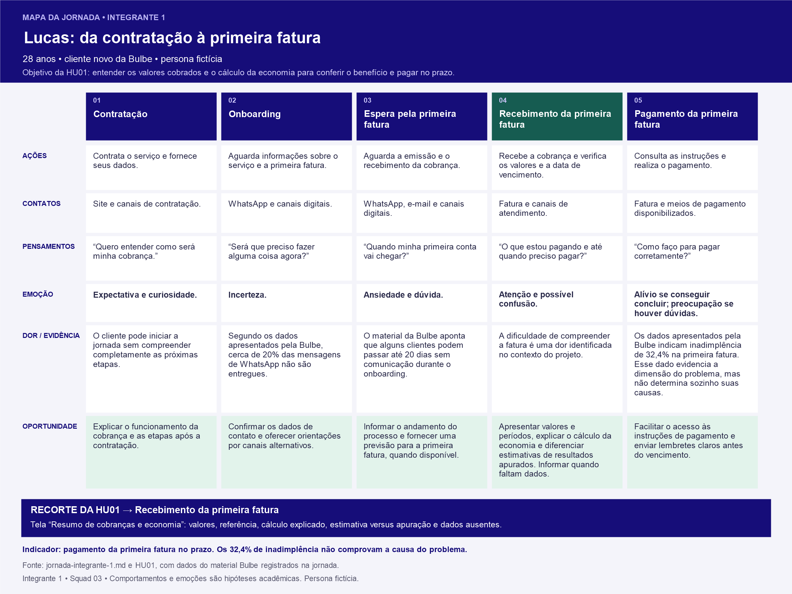

# Jornada do usuário — Integrante 1

## 1. Persona relacionada

[Lucas, 28 anos — Persona do integrante 1](../personas/persona-integrante-1.md).

## 2. Mapa da jornada

[Baixar o mapa em PNG](../wireframes/jornada-integrante-1.png). A tabela abaixo mantém o conteúdo em formato textual acessível.

| Fase | Ações | Pontos de contato | Pensamentos | Emoção | Dor (com evidência da Bulbe) | Oportunidade |
|---|---|---|---|---|---|---|
| Contratação | Contrata o serviço e fornece seus dados. | Site e canais de contratação. | “Quero entender como será minha cobrança.” | Expectativa e curiosidade. | O cliente pode iniciar a jornada sem compreender completamente as próximas etapas. | Explicar o funcionamento da cobrança e as etapas após a contratação. |
| Onboarding | Aguarda informações sobre o serviço e a primeira fatura. | WhatsApp e canais digitais. | “Será que preciso fazer alguma coisa agora?” | Incerteza. | Segundo os dados apresentados pela Bulbe, cerca de 20% das mensagens de WhatsApp não são entregues. | Confirmar os dados de contato e oferecer orientações por canais alternativos. |
| Espera pela primeira fatura | Aguarda a emissão e o recebimento da cobrança. | WhatsApp, e-mail e canais digitais. | “Quando minha primeira conta vai chegar?” | Ansiedade e dúvida. | O material da Bulbe aponta que alguns clientes podem passar até 20 dias sem comunicação durante o onboarding. | Informar o andamento do processo e fornecer uma previsão para a primeira fatura, quando disponível. |
| Recebimento da primeira fatura | Recebe a cobrança e verifica os valores e a data de vencimento. | Fatura e canais de atendimento. | “O que estou pagando e até quando preciso pagar?” | Atenção e possível confusão. | A dificuldade de compreender a fatura é uma dor identificada no contexto do projeto. | Apresentar valores e períodos, explicar o cálculo da economia e diferenciar estimativas de resultados apurados. Informar quando faltam dados. |
| Pagamento da primeira fatura | Consulta as instruções e realiza o pagamento. | Fatura e meios de pagamento disponibilizados. | “Como faço para pagar corretamente?” | Alívio se conseguir concluir; preocupação se houver dúvidas. | Os dados apresentados pela Bulbe indicam inadimplência de 32,4% na primeira fatura. Esse dado evidencia a dimensão do problema, mas não determina sozinho suas causas. | Facilitar o acesso às instruções de pagamento e enviar lembretes claros antes do vencimento. |

## 3. Principais oportunidades identificadas

1. **Melhorar a comunicação no onboarding:** manter o cliente informado sobre as próximas etapas.
2. **Reduzir falhas de contato:** confirmar os dados fornecidos e disponibilizar canais alternativos de comunicação.
3. **Tornar a primeira fatura mais compreensível:** destacar valores, vencimento e instruções de pagamento.
4. **Facilitar o pagamento:** disponibilizar orientações claras e lembretes antes do vencimento.

## 4. Indicador relacionado à dor escolhida

**Indicador principal:** percentual de clientes inadimplentes na primeira fatura.

O material do projeto apresenta uma taxa de inadimplência de 32,4% na primeira fatura. Esse indicador poderá ser utilizado para avaliar se as melhorias propostas contribuem para reduzir a inadimplência.

## 5. Relação entre jornada e solução proposta

A jornada mostra que a falta de comunicação, a incerteza sobre a primeira cobrança e as possíveis dificuldades para compreender e pagar a fatura são pontos que merecem investigação.

A [HU01 — Entender os valores e a economia](../../historias/historia-integrante-1.md) concentra-se no recebimento da primeira fatura. A tela “Resumo de cobranças e economia” deve apresentar valores e períodos de referência, comparar com o valor sem o serviço quando disponível, explicar o cálculo e distinguir economia estimada de economia apurada. Se faltarem dados, deve informar essa limitação. A hipótese é que compreender a cobrança ajude Lucas a pagar a primeira fatura no prazo.

As hipóteses levantadas nesta jornada deverão ser validadas pelo grupo e relacionadas às histórias de usuário e às telas do MVP.
