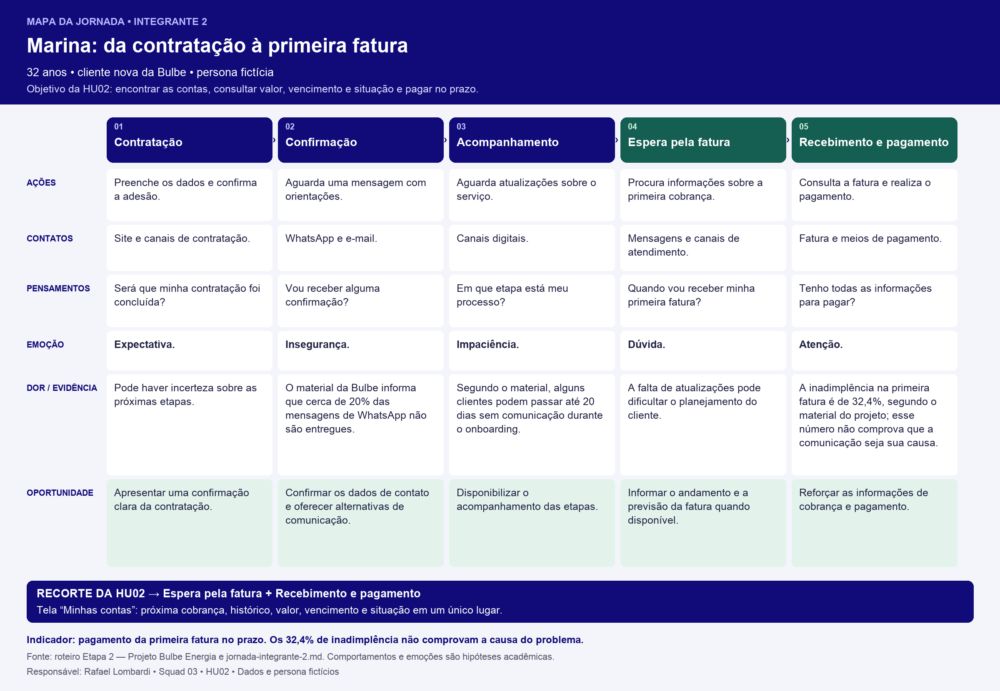

# Jornada do usuário — Integrante 2

## 1. Persona relacionada

[Marina, 32 anos — Persona do integrante 2](../personas/persona-integrante-2.md).

## 2. Mapa da jornada

[Baixar o mapa em PNG](../wireframes/jornada-integrante-2.png). A tabela abaixo mantém o conteúdo em formato textual acessível.

| Fase | Ações | Pontos de contato | Pensamentos | Emoção | Dor e evidência | Oportunidade |
|---|---|---|---|---|---|---|
| Contratação | Preenche os dados e confirma a adesão. | Site e canais de contratação. | “Será que minha contratação foi concluída?” | Expectativa. | Pode haver incerteza sobre as próximas etapas. | Apresentar uma confirmação clara da contratação. |
| Confirmação | Aguarda uma mensagem com orientações. | WhatsApp e e-mail. | “Vou receber alguma confirmação?” | Insegurança. | O material da Bulbe informa que cerca de 20% das mensagens de WhatsApp não são entregues. | Confirmar os dados de contato e oferecer alternativas de comunicação. |
| Acompanhamento | Aguarda atualizações sobre o serviço. | Canais digitais. | “Em que etapa está meu processo?” | Impaciência. | Segundo o material, alguns clientes podem passar até 20 dias sem comunicação durante o onboarding. | Disponibilizar o acompanhamento das etapas. |
| Espera pela fatura | Procura informações sobre a primeira cobrança. | Mensagens e canais de atendimento. | “Quando vou receber minha primeira fatura?” | Dúvida. | A falta de atualizações pode dificultar o planejamento do cliente. | Informar o andamento e a previsão da fatura quando disponível. |
| Recebimento e pagamento | Consulta a fatura e realiza o pagamento. | Fatura e meios de pagamento. | “Tenho todas as informações para pagar?” | Atenção. | A inadimplência na primeira fatura é de 32,4%, segundo o material do projeto; esse número não comprova que a comunicação seja sua causa. | Reforçar as informações de cobrança e pagamento. |

## 3. Principais oportunidades

1. Confirmar a contratação e os dados de contato.
2. Melhorar a continuidade da comunicação durante o onboarding.
3. Permitir que o cliente acompanhe as etapas do processo.
4. Informar a previsão da primeira fatura quando houver dados disponíveis.

## 4. Indicador relacionado

**Indicador principal do projeto:** percentual de clientes inadimplentes na primeira fatura.

O material apresenta uma taxa de 32,4%. A proposta é investigar se melhorias na comunicação contribuem para sua redução.

## 5. Relação com o MVP

A jornada sugere funcionalidades de confirmação da contratação, acompanhamento das etapas e consulta à previsão da primeira fatura. As hipóteses devem ser validadas pelo grupo antes de serem transformadas em histórias de usuário.
