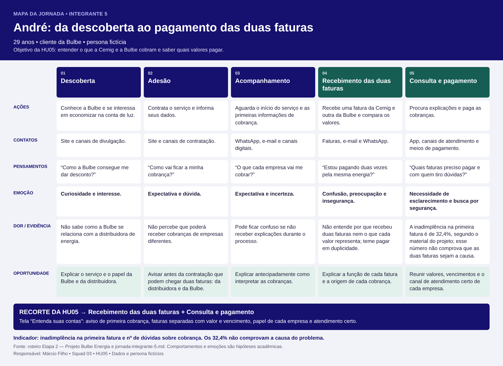

# Jornada do usuário — Integrante 5

## 1. Persona relacionada

[André, 29 anos — Persona do integrante 5](../personas/persona-integrante-5.md).

## 2. Mapa da jornada

[Baixar o mapa em PNG](../wireframes/jornada-integrante-5.png). A tabela abaixo mantém o conteúdo em formato textual acessível.

| Fase | Ações | Pontos de contato | Pensamentos | Emoção | Dor e evidência | Oportunidade |
|---|---|---|---|---|---|---|
| Descoberta | Conhece a Bulbe e se interessa em economizar na conta de luz. | Site e canais de divulgação. | “Como a Bulbe consegue me dar desconto?” | Curiosidade e interesse. | Não sabe como a Bulbe se relaciona com a distribuidora de energia. | Explicar o serviço e o papel da Bulbe e da distribuidora. |
| Adesão | Contrata o serviço e informa seus dados. | Site e canais de contratação. | “Como vai ficar a minha cobrança?” | Expectativa e dúvida. | Não percebe que poderá receber cobranças de empresas diferentes. | Avisar antes da contratação que podem chegar duas faturas: da distribuidora e da Bulbe. |
| Acompanhamento | Aguarda o início do serviço e as primeiras informações de cobrança. | WhatsApp, e-mail e canais digitais. | “O que cada empresa vai me cobrar?” | Expectativa e incerteza. | Pode ficar confuso se não receber explicações durante o processo. | Explicar antecipadamente como interpretar as cobranças. |
| Recebimento das duas faturas | Recebe uma fatura da Cemig e outra da Bulbe e compara os valores. | Faturas, e-mail e WhatsApp. | “Estou pagando duas vezes pela mesma energia?” | Confusão, preocupação e insegurança. | Não entende por que recebeu duas faturas nem o que cada valor representa; teme pagar em duplicidade. | Explicar a função de cada fatura e a origem de cada cobrança. |
| Consulta e pagamento | Procura explicações e paga as cobranças. | App, canais de atendimento e meios de pagamento. | “Quais faturas preciso pagar e com quem tiro dúvidas?” | Necessidade de esclarecimento e busca por segurança. | A inadimplência na primeira fatura é de 32,4%, segundo o material do projeto; esse número não comprova que as duas faturas sejam a causa. | Reunir valores, vencimentos e o canal de atendimento certo de cada empresa. |

## 3. Principais oportunidades

1. Explicar desde a descoberta o papel da Bulbe e da distribuidora.
2. Avisar, antes e depois da adesão, que o cliente pode receber duas faturas.
3. Mostrar o que cada fatura cobra, com valor e vencimento.
4. Indicar o canal de atendimento certo para cada cobrança.

## 4. Indicador relacionado

**Indicador principal do projeto:** percentual de clientes inadimplentes na primeira fatura.

O material apresenta uma taxa de 32,4%. Esse indicador acompanha o problema geral, mas não mede diretamente a compreensão das duas faturas; por isso, também deve ser acompanhado o número de dúvidas e pedidos de esclarecimento sobre cobrança.

## 5. Relação com o MVP

A [HU05 — Entender as contas da Cemig e da Bulbe](../../historias/historia-integrante-5.md) concentra-se nas etapas “Recebimento das duas faturas” e “Consulta e pagamento”. A tela [“Entenda suas contas”](../wireframes/hu05-contas-cemig-bulbe.md) apresenta o aviso de primeira cobrança, as faturas separadas com valor e vencimento, o papel de cada empresa e o atendimento adequado. A hipótese é que entender as duas cobranças ajude André a pagar ambas no prazo.

As dores descritas nesta jornada são hipóteses a validar pelo grupo, não fatos comprovados sobre todos os clientes da Bulbe.
