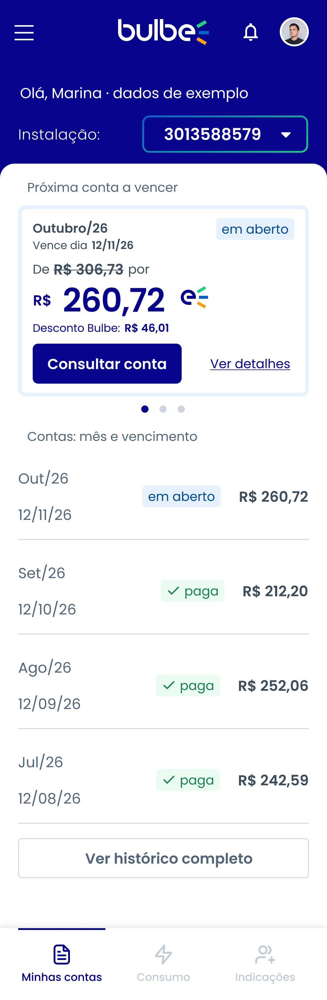

# HU02 — Minhas contas

**Responsável:** Rafael Lombardi (@RLrafael01).  
**História:** [HU02](../../historias/historia-integrante-2.md) · [Issue de entrega #15](https://github.com/enzokhalil/202602-projeto1-turmaB-squad03/issues/15).  
**Persona:** [Marina](../personas/persona-integrante-2.md).  
**Jornada:** [Integrante 2](../jornadas/jornada-integrante-2.md), etapas “Espera pela fatura” e “Recebimento e pagamento”.

[Figma — tela adaptada de Rafael](https://www.figma.com/design/0fiYX7OHkJlNkgFs3V4f3l?node-id=5-1726).

Exportação PNG da tela adaptada no Figma, em 3x (1080 × 3300 px); quadro de 360 × 1100 px. A original permanece ao lado da adaptação no Figma.

## Dor e proposta

Marina precisa localizar suas contas e consultar valor, vencimento e situação para organizar o pagamento. A tela reúne a próxima conta a vencer e o histórico, com referência, vencimento, valor e situação por escrito. O acesso “Minhas contas” fica visível na navegação.

O indicador pretendido é o pagamento da primeira fatura no prazo. A inadimplência de 32,4% apresentada no roteiro motiva a investigação; a imagem não comprova melhoria do indicador. Nomes, números e valores são exemplos fictícios, como indicado na tela.

## Navegação prevista

- Entrada: início do aplicativo → Minhas contas.
- “Consultar conta” / “Ver detalhes”: abrir a conta selecionada; o detalhamento deverá oferecer retorno a Minhas contas.
- “Ver histórico completo”: consultar contas anteriores.
- Barra inferior: Minhas contas, Consumo e Indicações.
- Integração prevista na HU02: explicações sobre as cobranças → HU05; atendimento → HU06. Os destinos finais serão combinados pelo squad.

## Limites desta entrega

Wireframe estático da tela principal, sem protótipo clicável ou pagamento real. A imagem representa contas em aberto e pagas. Os estados de previsão, vencida, lista vazia, carregamento e erro previstos na história, assim como a tela de detalhes e as conexões funcionais, deverão ser detalhados/implementados na Sprint 2. A apresentação e o registro da Sprint Review I serão realizados pelo squad; esta publicação não afirma que já aconteceram.
