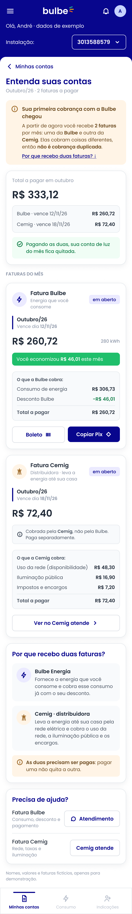

# HU05 — Entender as contas da Cemig e da Bulbe

**Responsável:** Márcio Filho (@marcio-lcf).
**História:** [HU05](../../historias/historia-integrante-5.md) · [Issue de entrega #18](https://github.com/enzokhalil/202602-projeto1-turmaB-squad03/issues/18).
**Persona:** André, descrita na jornada do integrante 5.
**Jornada:** [Integrante 5](../jornadas/jornada-integrante-5.md), etapas “Recebimento das duas faturas” e “Consulta e pagamento”.

[Figma — tela adaptada de Márcio](https://www.figma.com/design/0fiYX7OHkJlNkgFs3V4f3l?node-id=55-307).

Exportação PNG da tela adaptada no Figma, em 2x (720 × 4950 px); quadro de 360 × 2475 px. A tela original de detalhe da conta permanece ao lado da adaptação no Figma.

## Dor e proposta

André recebe uma fatura da Cemig e outra da Bulbe e não entende por que existem duas cobranças. Ele fica com receio de pagar duas vezes pelo mesmo serviço ou de deixar uma delas em aberto.

A tela “Entenda suas contas” reúne:

- aviso de primeira cobrança, explicando que o cliente passa a receber duas faturas e que não é cobrança duplicada;
- total do mês, com valor e vencimento de cada fatura;
- as faturas Bulbe e Cemig separadas, cada uma com o que está sendo cobrado;
- explicação “Por que recebo duas faturas?”, com o papel de cada empresa;
- canal de atendimento adequado para cada fatura.

O indicador pretendido é o percentual de inadimplência na primeira fatura, acompanhado do número de dúvidas sobre cobrança. A inadimplência de 32,4% apresentada no roteiro motiva a investigação; a relação entre as duas faturas e os atrasos é uma hipótese, e a imagem não comprova melhoria do indicador. Nomes, números e valores são exemplos fictícios, como indicado na tela.

## Navegação prevista

- Entrada: Minhas contas (HU02) → “Ver detalhes” da conta do mês, ou toque no aviso de primeira cobrança.
- “← Minhas contas” e aba Minhas contas: retorno à HU02.
- “Boleto” / “Copiar Pix”: pagamento da fatura Bulbe.
- “Ver no Cemig atende”: consulta e pagamento da fatura Cemig, fora do aplicativo.
- “Atendimento”: dúvidas sobre a fatura Bulbe → HU06. “Cemig atende”: dúvidas sobre a fatura Cemig.
- Barra inferior: Minhas contas, Consumo e Indicações.
- Os destinos finais serão combinados pelo squad.

## Limites desta entrega

Wireframe estático da tela de explicação das contas, sem protótipo clicável ou pagamento real. A imagem representa o mês da primeira cobrança, com as duas faturas em aberto. Os estados de fatura paga, vencida, mês com uma só fatura, carregamento e erro deverão ser detalhados/implementados na Sprint 2. A apresentação e o registro da Sprint Review I serão realizados pelo squad; esta publicação não afirma que já aconteceram.
