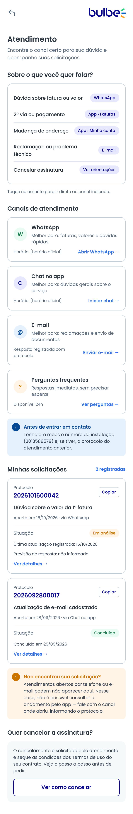

# HU06 — Atendimento e acompanhamento de solicitações

**Responsável:** Caio Campos (@Caiocampos21).
**História:** [HU06](../../historias/historia-integrante-6.md) · [Issue de entrega #19](https://github.com/enzokhalil/202602-projeto1-turmaB-squad03/issues/19).
**Persona:** [Sônia](../personas/persona-integrante-6.md).
**Jornada:** [Integrante 6](../jornadas/jornada-integrante-6.md), etapas “Espera” e “Consulta da fatura”.

[Figma — telas adaptadas de Caio](https://www.figma.com/design/0fiYX7OHkJlNkgFs3V4f3l?node-id=24-180).

Telas exportadas do Figma, em 2x, com quadros de 360 px de largura:

| Tela | Arquivo | Figma | Quadro |
|---|---|---|---|
| 01 · Menu lateral → Atendimento | `hu06-menu-lateral.png` | [node 24-179](https://www.figma.com/design/0fiYX7OHkJlNkgFs3V4f3l?node-id=24-179) | 360 × 812 px |
| 02 · Atendimento — com solicitações | `hu06-atendimento.png` | [node 24-180](https://www.figma.com/design/0fiYX7OHkJlNkgFs3V4f3l?node-id=24-180) | 360 × 2184 px |
| 03 · Atendimento — sem solicitações | `hu06-atendimento-sem-solicitacoes.png` | [node 24-324](https://www.figma.com/design/0fiYX7OHkJlNkgFs3V4f3l?node-id=24-324) | 360 × 1043 px |
| 04 · Detalhe da solicitação | `hu06-detalhe-solicitacao.png` | [node 24-386](https://www.figma.com/design/0fiYX7OHkJlNkgFs3V4f3l?node-id=24-386) | 360 × 938 px |
| 05 · Detalhe — andamento indisponível | `hu06-detalhe-indisponivel.png` | [node 24-454](https://www.figma.com/design/0fiYX7OHkJlNkgFs3V4f3l?node-id=24-454) | 360 × 800 px |
| 06 · Como cancelar a assinatura | `hu06-como-cancelar.png` | [node 24-490](https://www.figma.com/design/0fiYX7OHkJlNkgFs3V4f3l?node-id=24-490) | 360 × 909 px |

A tela 01 é a original do professor, com o item do menu renomeado; as telas 02 a 06 são novas. A original permanece preservada no arquivo do professor, e o trabalho foi feito em cópia na página “Caio Campos — HU06” do Figma do squad.

## Dor e proposta

Sônia tem uma dúvida ou uma solicitação em andamento e não sabe a qual canal recorrer nem em que etapa está o seu pedido. Ela teme ficar sem resposta, perder o protocolo e não conseguir cancelar quando quiser.

As telas reúnem:

- no menu lateral, o item “Fale conosco” renomeado para “Atendimento e solicitações”, deixando claro que ali também se acompanham pedidos (tela 01);
- o guia “Sobre o que você quer falar?”, que indica o canal para cada assunto: fatura ou valor (WhatsApp), 2ª via ou pagamento (App › Faturas), mudança de endereço (App › Minha conta), reclamação ou problema técnico (E-mail) e cancelamento (ver orientações) (tela 02);
- os canais de atendimento — WhatsApp, Chat no app, E-mail e Perguntas frequentes — com a indicação de para que serve cada um (tela 02);
- a lista “Minhas solicitações”, com protocolo em destaque e botão “Copiar”, assunto, data e canal de abertura, situação, última atualização registrada e “Previsão de resposta: não informada” quando não há prazo (tela 02);
- o aviso “Não encontrou sua solicitação?”, explicando que atendimentos abertos por telefone ou e-mail podem não aparecer e que, nesse caso, não é possível consultar o andamento pelo app (tela 02);
- o estado sem solicitações, que orienta como entrar em contato pelo WhatsApp ou por todos os canais e lembra de guardar o protocolo informado por telefone ou e-mail (tela 03);
- o detalhe da solicitação, com protocolo grande e botão “Copiar”, dados da solicitação, linha do tempo só com eventos registrados e o aviso “Sem previsão informada” (tela 04);
- o estado de limitação, que informa que não foi possível consultar o andamento pelo app, explica que isso não significa pedido encerrado e indica o próximo passo (tela 05);
- o passo a passo do cancelamento conforme os Termos de Uso, com o lembrete de que a fatura da Cemig continua chegando e um convite para falar com o atendimento antes de cancelar, sem esconder o botão de cancelamento (tela 06).

O indicador pretendido é o churn do 1º mês. Os slides da Aula 19 informam churn pós 1ª fatura com média de 2,14% ao mês em 2026 e pico de 3,39% em nov/24; esse dado motiva a investigação, mas não comprova que a dificuldade de contato ou de acompanhamento seja a causa dos cancelamentos, e as imagens não comprovam redução do churn. Nomes, protocolos, datas e números de instalação são exemplos fictícios.

## Critérios de aceite atendidos

| Critério | Onde aparece |
|---|---|
| Canais e orientações de uso | Tela 02, seção “Canais de atendimento” |
| Identificar o canal mais adequado | Tela 02, guia “Sobre o que você quer falar?” |
| Informações de cada solicitação | Telas 02 e 04 |
| Protocolo de forma clara | Telas 02, 04 e 05, com botão “Copiar” |
| Situação sem inventar atualizações ou prazos | Telas 02 e 04 (“Previsão de resposta: não informada” e “Sem previsão informada”) |
| Sem solicitação registrada | Tela 03 |
| Orientações de cancelamento | Telas 02 (atalho) e 06 |
| Limitação de consulta pelo sistema | Telas 02 (aviso) e 05 |

## Navegação prevista

- Entrada: menu lateral → “Atendimento e solicitações” (tela 01). Também a partir de “Atendimento” na tela de explicação das contas ([HU05](hu05-contas-cemig-bulbe.md)).
- Tela 02: “Ver detalhes →” abre o detalhe da solicitação (tela 04); “Ver como cancelar” abre o passo a passo (tela 06); “Abrir WhatsApp →”, “Iniciar chat →”, “Enviar e-mail →” e “Ver perguntas →” levam aos canais.
- Tela 03: “Falar no WhatsApp” e “Ver todos os canais”.
- Tela 04: “Falar sobre este protocolo” e “Copiar protocolo”.
- Tela 05: “Falar no WhatsApp com o protocolo” e “Tentar novamente”.
- Tela 06: “Ler Termos de Uso”, “Solicitar cancelamento pelo WhatsApp” e “Falar com o atendimento →”.
- Saída: seta de voltar no topo de cada tela.
- Os destinos finais serão combinados pelo squad.

## Limites desta entrega

Wireframes estáticos, sem protótipo clicável, sem abertura de chamado real e sem integração com o atendimento da Bulbe. Os horários de WhatsApp e Chat no app aparecem como “[horário oficial]” e devem ser preenchidos com a informação oficial da Bulbe. Os passos de cancelamento e as condições dependem dos Termos de Uso e devem ser confirmados com a Bulbe antes da implementação. Os estados de carregamento e erro de rede ainda não estão desenhados. A versão funcional em HTML, CSS e JavaScript com dados fictícios, na branch `hu06-atendimento-solicitacoes`, será entregue na Sprint 2 e ainda não foi validada com clientes. A apresentação e o registro da Sprint Review I serão realizados pelo squad; esta publicação não afirma que já aconteceram.